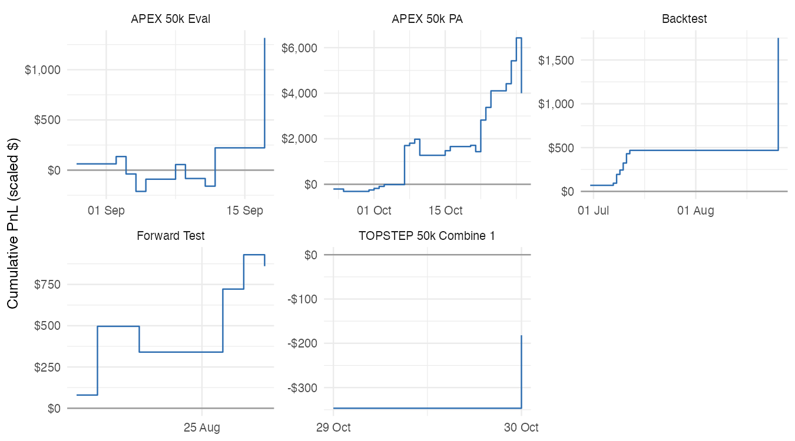

# MNQ Trading Case Study: Do I Have an Edge?

Analysis of 50 trading days and 51 journalled trades from my 2025 MNQ / Nasdaq-100
futures journal (backtest, forward test, prop-firm evaluations and a funded account),
built in R and published as a Quarto report.

**[Read the report](https://vaughnantonio.github.io/mnq-trading-case-study/analysis/report.html)**



## Key findings

- **No edge proven yet.** Every stage was profitable, but every group has fewer than
  30 days and most 95% confidence intervals cross zero.
- **Position size, not setup choice, is the main risk.** My worst funded day was 2.8×
  the account's whole drawdown limit. Earlier profits saved the account; a fresh one
  would have failed.
- **Days I tagged "Gamba" (gambling) lost heavily**; ModelV2 days were positive.
- **The backtest looks too good** (100% winning days): a sign of hindsight bias.
- **The market helped.** In my live window, a strong Nasdaq uptrend, passively holding
  1 MNQ did as well or better per unit of size.
- **Journalling gaps limit the analysis.** Only 9% of funded trades were written up,
  so setup grades (A/B/C) cannot be compared yet.

## Questions

| # | Question | Answer |
|---|---|---|
| Q1 | Win rate, average win/loss, expectancy per trade? | Positive in every stage; not significant |
| Q2 | Do A setups beat B and C? | Not enough data |
| Q3 | Which strategy performs best? | Cannot separate strategy from stage; "Gamba" days worst |
| Q4 | Does performance drop from backtest to live? | Win rate drops from backtest to eval |
| Q5 | Drawdowns vs prop-firm limits? | No end-of-day breach; one day at 2.8× the limit |
| Q6 | Trend days vs choppy days? | Trend days weakest in every live stage (small n) |
| Q7 | Journal vs a simple MA trend rule? | Passive holding matched or beat me per unit of size |

## Method

1. **Extract**: Notion API (`httr2`); trade lines parsed from screenshot captions with regex.
2. **Clean**: typed fixes logged in `data/processed/manual_fixes.csv`, applied in code.
3. **Metrics**: expectancy in R multiples, bootstrap 95% confidence intervals,
   prop-firm trailing-threshold rules.
4. **Market context**: MNQ daily bars from Yahoo, trend/chop tagging, MA 20/50 benchmark.
5. **Report**: Quarto, rendered to GitHub Pages.

## Tools

R, tidyverse, httr2 (Notion API), tidyquant, TTR, PerformanceAnalytics, gt, Quarto, renv

## Repo structure

```
R/00_setup.R               packages, theme, shared helpers
R/01_extract_journal.R     Notion API -> raw tables (private)
R/02_clean_trades.R        clean days and trades, R multiples
R/03_get_market_data.R     MNQ=F daily prices
R/04_metrics.R             Q1-Q5
R/05_market_regimes.R      Q6
R/06_benchmark_ma.R        Q7
R/07_make_public_data.R    anonymised public data
analysis/report.qmd        the report
data/public/               anonymised journal data (scaled dollars)
data/market/               MNQ daily prices and regime tags
docs/                      rendered report (GitHub Pages)
```

## Reproduce

1. Clone the repo and open `mnq-trading-case-study.Rproj`.
2. `renv::restore()`
3. `quarto::quarto_render("analysis/report.qmd")`

The report reads only `data/public/` and `data/market/`. Scripts `01`–`07` need my
private Notion journal and are included to show the method.

## Data note

The raw journal is private. Public files contain no notes, contract sizes or account
numbers, and every dollar value is multiplied by one hidden factor. Win rates, ratios
and R multiples are unchanged.

## Licence

MIT
